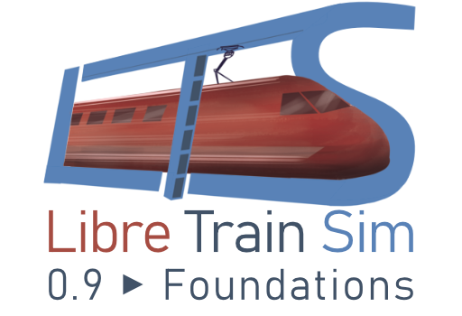

[Libre Train Sim](https://libretrainsim.de) is a free and open source train driving simulator created using the Godot Engine. It is licensed under the [GPL v3 license](LICENSE).

**[Play](https://www.libretrainsim.de/download/)** ► **[Contribute](https://github.com/Libre-TrainSim/Libre-TrainSim/wiki/Contribute-to-Libre-TrainSim)**

---

## About

This project was initially created by Jean28518. As the project attracted new contributors, we moved the repository into the [Libre Train Sim Organisation](https://github.com/Libre-TrainSim/). We want to create a modern, fully free train driving simulator running on Linux, Mac, Windows, and Android.

## Leave Feedback

Nothing is perfect. If you found a bug, please feel encouraged to create a [bug report](https://github.com/Libre-TrainSim/Libre-TrainSim/issues/new/). If you want to give more detailed feedback, you can fill out this [form](https://www.libretrainsim.org/feedback/).

**Thank you! :heart:**

## Development Progress

[Follow the development here](https://github.com/Libre-TrainSim/Libre-TrainSim/projects)

## Installation (for contributors)

Fork and clone the repository. Install **[Godot 4.4](https://godotengine.org/download/archive/4.4-stable/)** (or newer compatible 4.x). Open **`src/project.godot`** as the project root.

### CI and local checks

Continuous integration imports the project with `godot --headless --path src --import`, then runs `src/tools/ci_validate_scripts.gd` to catch **GDScript parse errors**. Locally:

```bash
export GODOT_BIN="/path/to/Godot_v4.4-stable_linux.x86_64"
chmod +x scripts/ci_validate.sh
./scripts/ci_validate.sh
```

See [MODERNIZATION.md](MODERNIZATION.md) for the technical roadmap.

## Links

- Website: <https://www.libretrainsim.de/>
- GitHub: <https://www.github.com/Libre-TrainSim/Libre-TrainSim>
- YouTube: <https://www.youtube.com/channel/UCsPsL_AkVUZMmKOKJgm7xsQ>
- Itch.io: <https://jean28518.itch.io/libre-train-sim>
- Google Play: <https://play.google.com/store/apps/details?id=org.godotengine.libretrainsim>
- Flathub: <https://flathub.org/apps/details/org.libretrainsim.Libre-TrainSim>
- Discord: <https://discord.gg/AQdAtZZ>
